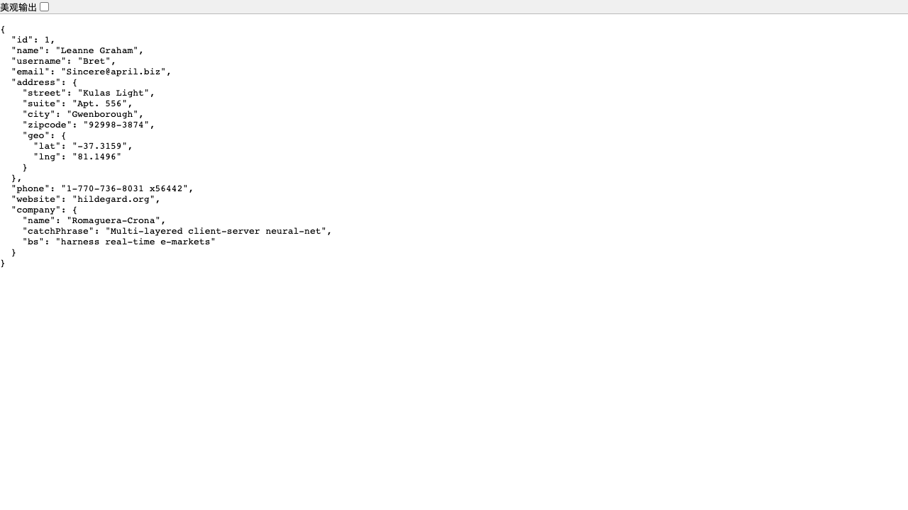

# 真实站点 E2E：jsonplaceholder 只读闭环

用公开站点 `jsonplaceholder.typicode.com` 跑了一遍 dataforge 主链路：

```text
真实 GET 采集样本
  → capture 库
  → dataforge_trace_analyze
  → dataforge_chain_draft（自动生成 n1 GET /users/1 → n2 GET /comments）
  → chain_upsert
  → chain_run 计划卡（0 请求）
  → 确认执行（真实 HTTP）
  → verify UI 验收（真实 Chrome）
  → dataset / evidence 自动导出
```

## 本次结果

- 链运行：`chain-真实只读闭环-1792334117371`
- UI 验收运行：`uir_mvdxghjb_fc3t9v`
- 链：`JsonPlaceholder / 真实只读闭环 v1`
- 节点 2、边 1
- 绑定：`n1.body.email` → `n2.query.email`
- 真实执行：2/2 节点完成
  - `GET /users/1` → 200
  - `GET /comments?email=Sincere%40april.biz` → 200
- UI verify：
  - 打开 `https://jsonplaceholder.typicode.com/users/1`
  - 断言 `body` 文本含 `Sincere@april.biz`
  - 结果 `success`
  - 截图：`success.png`（1280×720，页面 JSON 中可见 `Sincere@april.biz`）
- 产物：
  - `chain-dataset.json`
  - `ui-dataset.json`
  - `ui-report.html`
  - `success.png`

## 计划卡（真实回执，零请求）

```text
🧭 执行计划（JsonPlaceholder / 真实只读闭环 v1）→ jsonplaceholder.typicode.com
1. n1：GET /users/1
2. n2：GET /comments
写类节点：无（整链只读）
确认后带 confirm=true 重调即真跑；只想留档用 dry_run=true（永不发请求）。
验收：JsonPlaceholder / 查看用户页（onSuccess）
```

## 复现

```bash
NODE_OPTIONS=--dns-result-order=ipv4first \
E2E_REAL=1 pnpm exec vitest run test/e2e/real-site.test.ts
```

默认不跑（`E2E_REAL` 未设置时跳过）；需要联网 + 本机 Chrome。

网络在本机偶发 IPv6 连接超时，测试里对真实 fetch 和链执行做了有限重试；这不是产品逻辑，只用于公网 E2E。

## 证据



- 链 YAML：[chain-v1.yaml](chain-v1.yaml)
- 链数据：[chain-dataset.json](chain-dataset.json)
- UI 数据：[ui-dataset.json](ui-dataset.json)
- UI 报告：[ui-report.html](ui-report.html)
